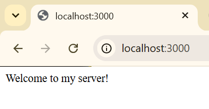
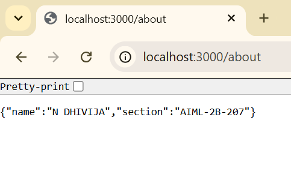
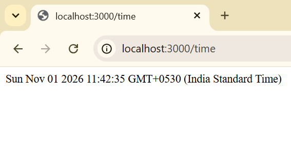
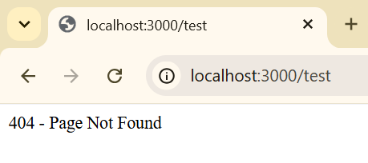

# Lab 01 – HTTP Server and Express Server

## Student Details

- **Name:** N DHIVIJA
- **Registration Number:** 252U1R6112
- **Section:** AIML-2B-207
- **Course:** Backend Development Fundamentals

## Live Deployment URL

**Render URL:** https://bdf-lab-01-a8zp.onrender.com

**Deployment Status:** Successfully deployed.

## 1. Objective

To understand the fundamentals of HTTP servers and Express.js by creating a server that handles different routes, returns responses, displays the current date and time, and handles invalid routes using a 404 response.

## 2. Technologies Used

- Node.js
- Express.js
- JavaScript
- Git and GitHub
- Render

## 3. Project Structure

```text
lab-01/
│
├── screenshots/
│   ├── home.png
│   ├── about.png
│   ├── time.png
│   └── not-found.png
│
├── .gitignore
├── package.json
├── package-lock.json
├── server.js
└── README.md
```

## 4. Installation and Execution

### Prerequisites

- Node.js installed
- npm installed

### Installation

```bash
npm install
```

### Run the server

```bash
node server.js
```

### Environment Variables

The server uses the following environment variable:

| Variable | Description | Default |
|---|---|---|
| PORT | Port on which the server runs | 3000 |

No additional environment variables are required.

## 5. API Endpoints

Base URL: https://bdf-lab-01-a8zp.onrender.com

| Method | Endpoint | Description |
|---|---|---|
| GET | `/` | Displays the welcome message. |
| GET | `/about` | Returns student name and section in JSON format. |
| GET | `/time` | Returns the current date and time. |
| GET | `/anything` | Demonstrates the 404 response for an invalid route. |

## 6. Screenshots of Working Output

### Home Endpoint

Displays the welcome message.



### About Endpoint

Displays student details in JSON format.



### Time Endpoint

Displays the current date and time.



### 404 Error Endpoint

Displays the page not found message for an invalid route.



## 7. Deployment

The Express server was successfully deployed using Render.

**Live URL:** https://bdf-lab-01-a8zp.onrender.com

All four endpoints were tested using the deployed public URL.

## 8. Conclusion

Successfully created and deployed an HTTP server using Node.js and Express.js. Learned how to configure routes, handle HTTP GET requests, send text and JSON responses, use environment variables, handle invalid routes, and deploy a backend application using Render.