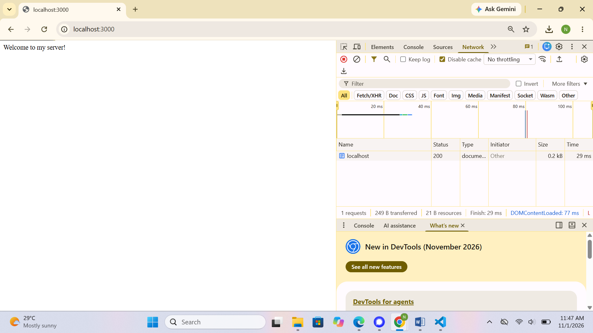
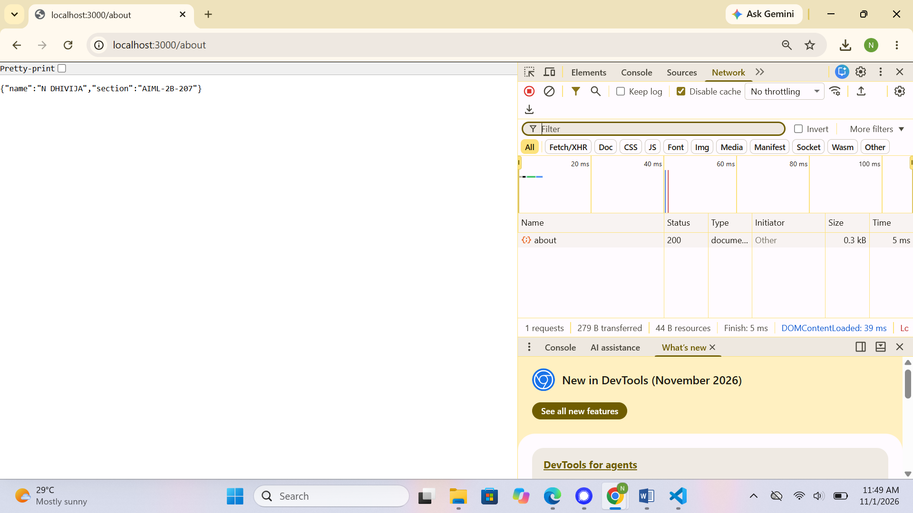
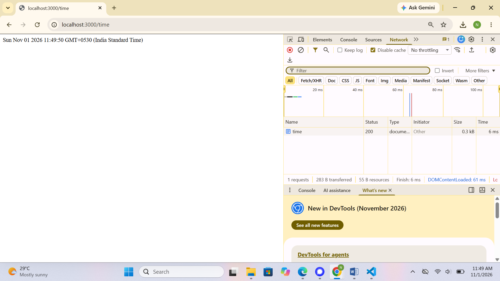
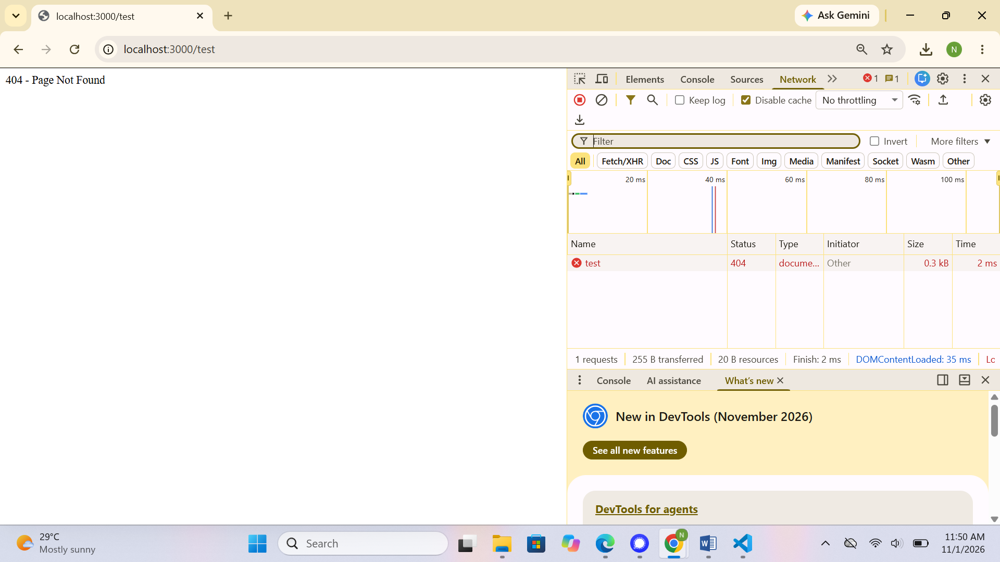

# Lab 01 – HTTP Server and Express Server

## Student Details

- **Name:** N DHIVIJA
- **Registration Number:** 252U1R6112
- **Section:** AIML-2B-207
- **Course:** Backend Development Fundamentals

## Live Deployment URL

**Status:** Deployment pending.

The application has not yet been deployed. The public URL will be added after successful deployment.

## 1. Introduction

This lab demonstrates the fundamentals of backend development using Node.js and Express.js. It involves creating an HTTP server, handling client requests, defining API endpoints, returning responses, and handling invalid routes.

## 2. Technologies Used

- Node.js
- Express.js
- JavaScript
- npm
- Visual Studio Code
- Postman / Web Browser

## 3. Project Structure

```text
lab-01/
│
├── screenshots/
│   ├── home.png
│   ├── about.png
│   ├── time.png
│   ├── not-found.png
│   ├── home-status.png
│   ├── about-status.png
│   ├── time-status.png
│   └── not-found-status.png
│
├── .gitignore
├── http-server.js
├── package.json
├── package-lock.json
├── server.js
└── README.md
```

## 4. Installation and Execution

### Prerequisites

- Node.js installed.
- npm installed.

### Step 1: Navigate to the project directory

```bash
cd lab-01
```

### Step 2: Install dependencies

```bash
npm install
```

### Step 3: Start the Express server

```bash
node server.js
```

The server runs on port 3000.

### Step 4: Open the application

Visit the following URL in your browser:

```text
http://localhost:3000
```

### Alternative: Run the native HTTP server

```bash
node http-server.js
```

Run only one server at a time because both use port 3000.

### Environment Variables

No environment variables are currently required. The server uses port 3000.

## 5. API Endpoints

| Method | Endpoint | Description |
|---|---|---|
| GET | `/` | Returns a welcome message. |
| GET | `/about` | Returns student information in JSON format. |
| GET | `/time` | Returns the current server date and time. |
| GET | Unknown routes | Returns a 404 Page Not Found response. |

## 6. Screenshots and Output

### 6.1 Home Endpoint

Displays the welcome message.


### 6.2 About Endpoint

Displays student information in JSON format.


### 6.3 Time Endpoint

Displays the current date and time.


### 6.4 Invalid Route

Displays a 404 Page Not Found response for an invalid route.


## 7. HTTP Status Code Verification

The following screenshots demonstrate the HTTP status codes returned by the server.

### Home Endpoint – Status 200



### About Endpoint – Status 200



### Time Endpoint – Status 200



### Invalid Route – Status 404



## 8. Conclusion

Through this lab, I learned how to create HTTP and Express servers using Node.js. I understood how to define GET endpoints, process client requests, return text and JSON responses, retrieve date and time information, and handle invalid routes using appropriate HTTP status codes.

This lab provided practical experience with backend development fundamentals and API request handling.