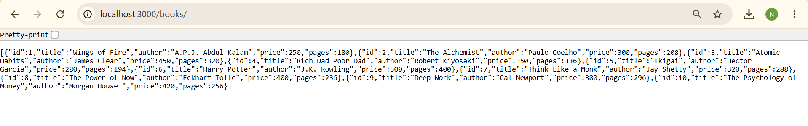
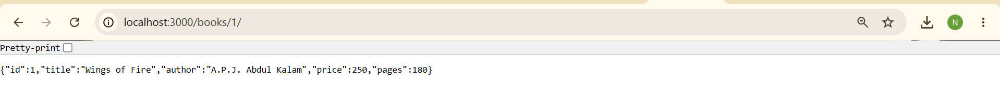
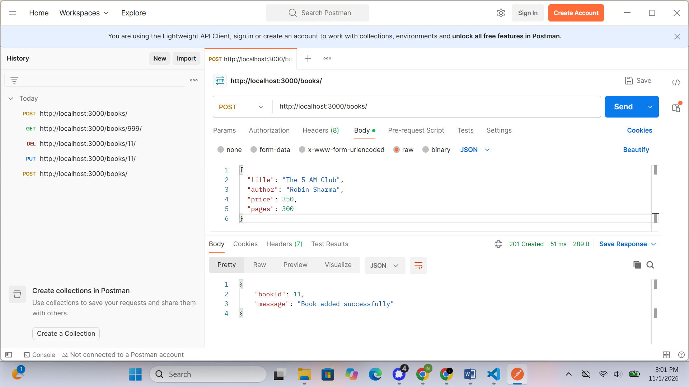
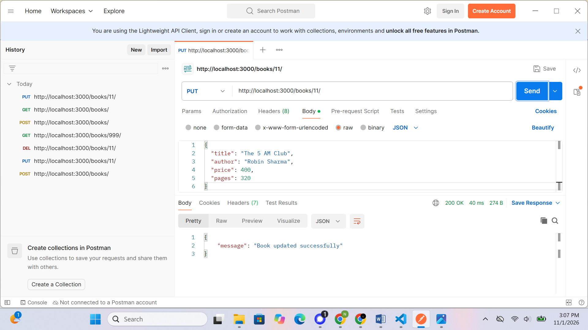
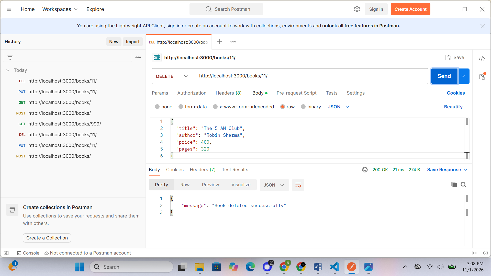
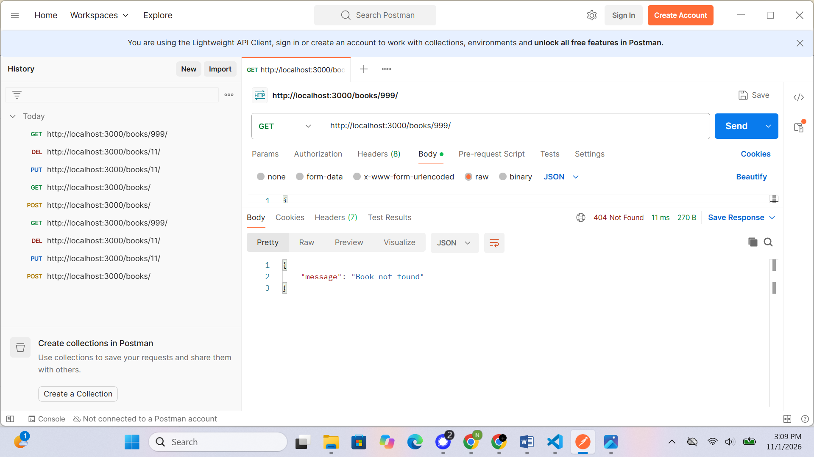
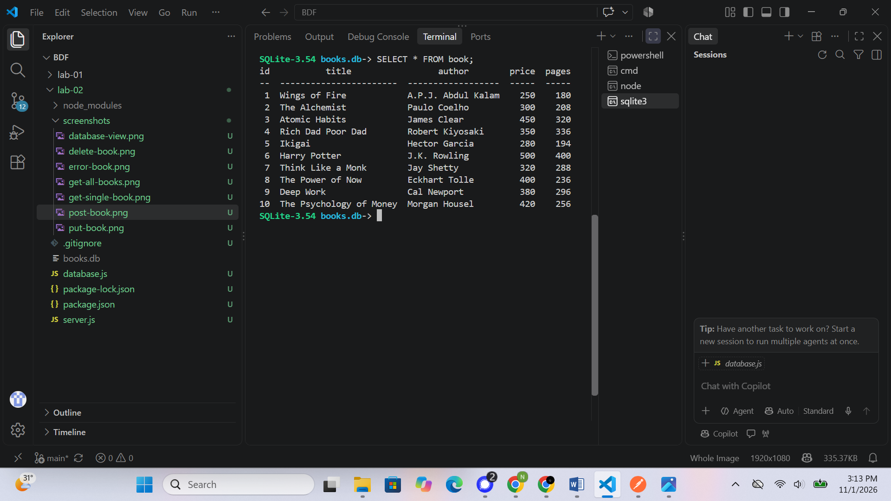

# Lab 2: SQLite Database and CRUD Routes

**Name:** N DHIVIJA  
**Registration Number:** 252U1R6112  
**Section:** AIML-2B-207

## Objective

To connect an Express.js server with an SQLite database and implement CRUD (Create, Read, Update, Delete) operations using HTTP routes.

## Technologies Used

- Node.js
- Express.js
- SQLite
- sqlite3
- Postman

## How to Run

1. Open the `lab-02` folder in the terminal.
2. Install the dependencies:

   ```bash
   npm install
   ```

3. Start the server in development mode:

   ```bash
   npm run dev
   ```

4. The server runs at:

   `http://localhost:3000`

## API Endpoints

| Method | Endpoint | Description |
|---|---|---|
| GET | `/books/` | Retrieve all books |
| GET | `/books/:bookId/` | Retrieve a book by ID |
| POST | `/books/` | Add a new book |
| PUT | `/books/:bookId/` | Update an existing book |
| DELETE | `/books/:bookId/` | Delete a book |

## Database

- Database file: `books.db`
- Table name: `book`
- Columns: `id`, `title`, `author`, `price`, `pages`
- Initial records: 10 books

## Screenshots

### Get All Books


### Get Single Book


### Add Book (POST)


### Update Book (PUT)


### Delete Book (DELETE)


### Error Handling


### Database View


## Conclusion

Successfully connected an Express.js server to an SQLite database and implemented all five CRUD operations. Tested the API endpoints using Postman and verified the database records using SQLite.

## Problems Faced and Solutions

- Resolved the SQLite CLI setup on Windows.
- Connected the Express server to the SQLite database.
- Tested successful and unsuccessful API requests using Postman.