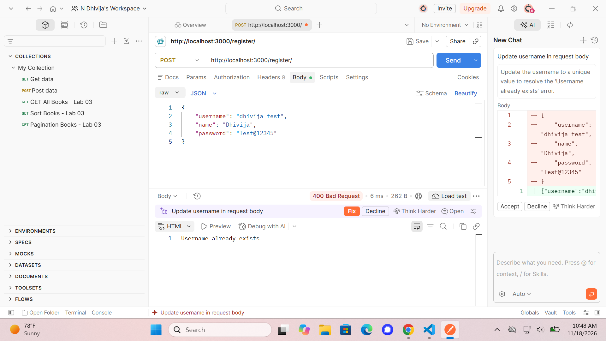
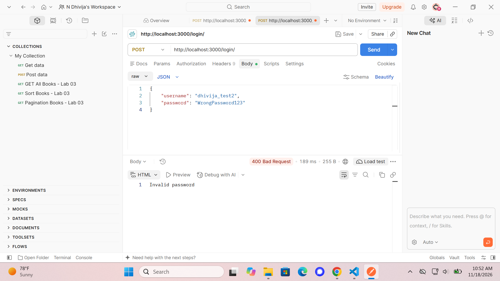
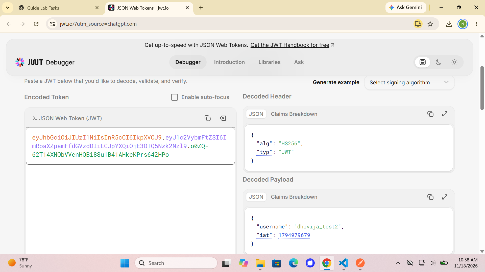
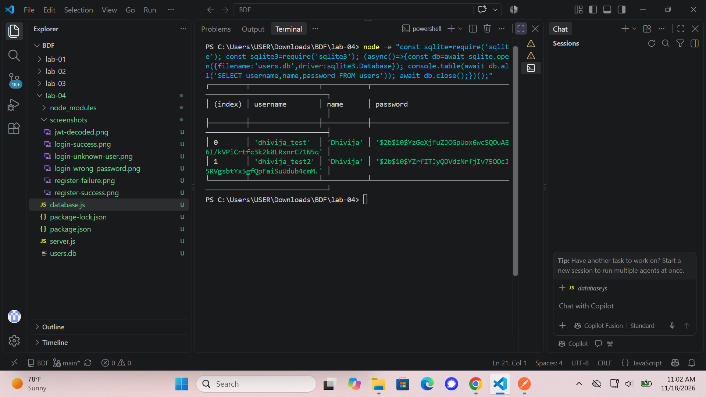

# Lab 4: Registration, Login and JWT

**Name:** N Dhivija  
**Registration Number:** 252U1R6112  
**Section:** S02

## Live Link
Deployment pending. The public URL will be added after deployment.

## Objective
To implement user registration and login using bcrypt password hashing and JSON Web Tokens (JWT) for authentication.

## Technologies Used
- Node.js
- Express.js
- SQLite
- bcrypt
- jsonwebtoken
- Postman

## How to Install and Run

1. Clone the repository.
2. Navigate to the lab-04 folder.
3. Install the dependencies:

```bash
npm install
```

4. Start the server:

```bash
node server.js
```

5. The server runs at:

```text
http://localhost:3000/
```

**Environment Variables:** No environment variables are required for this lab. The JWT secret is currently defined as a constant in `server.js`, as instructed.

## Endpoints

| Method | Endpoint | Description |
|---|---|---|
| POST | /register/ | Registers a new user with a hashed password. |
| POST | /login/ | Authenticates a user and returns a JWT token. |

## Implementation Details

- User passwords are hashed using `bcrypt.hash()`.
- Passwords are verified using `bcrypt.compare()`.
- Duplicate usernames are rejected.
- JWT tokens are generated using `jwt.sign()`.
- The JWT payload contains only the username.
- Parameterized SQL queries are used to prevent SQL injection.

## Screenshots

### 1. Successful Registration


### 2. Duplicate Username


### 3. Successful Login


### 4. Login with Wrong Password


### 5. Login with Unknown Username


### 6. JWT Decoded Output


### 7. Database Showing Hashed Passwords


## Problems Faced and Solutions

1. **PowerShell Execution Policy:** The npm command was blocked by PowerShell. This was resolved by using `npm.cmd`.
2. **Package Installation Scripts:** Installation scripts for bcrypt and sqlite3 required approval and rebuilding.
3. **JWT Verification:** The generated JWT token was decoded using jwt.io to inspect its header, payload and signature.

## Conclusion

Successfully implemented user registration and login using Express.js, SQLite, bcrypt and JWT. Verified password hashing, successful authentication, invalid login attempts and JWT token generation using Postman.