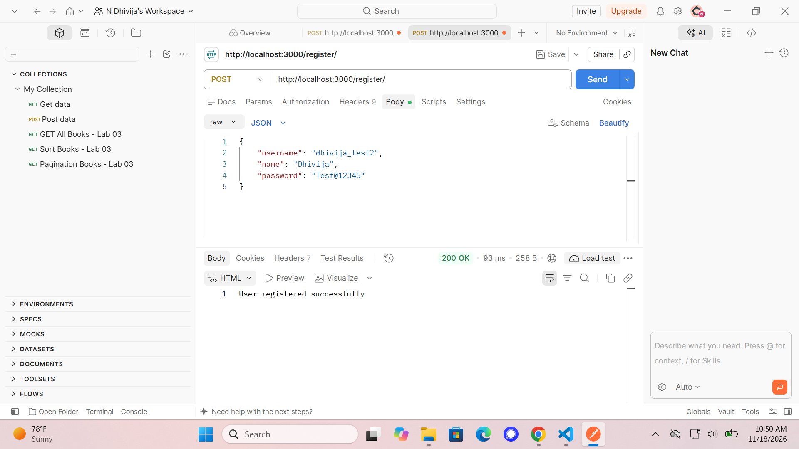
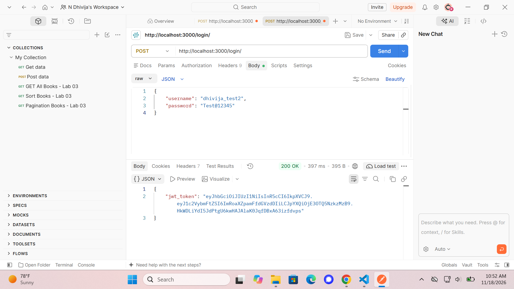
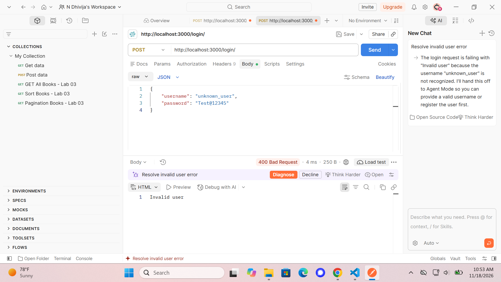
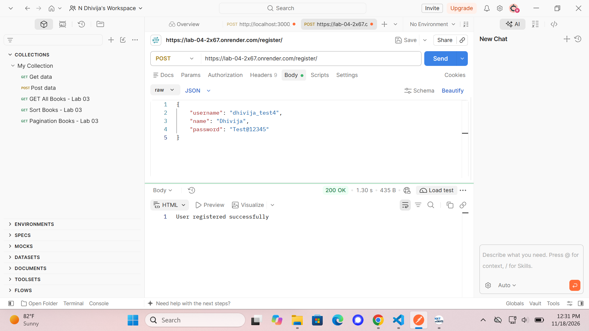
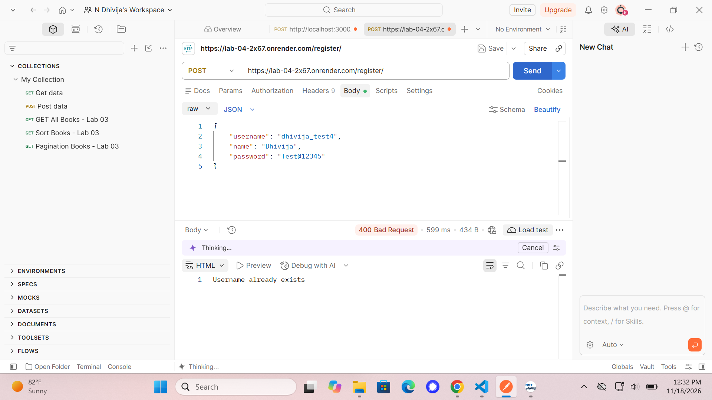
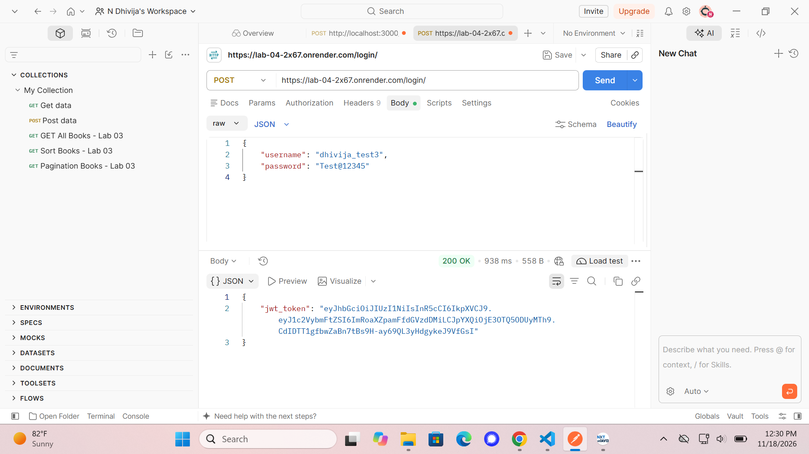
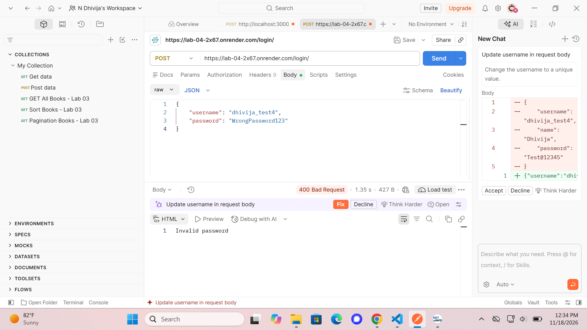

# Lab 4: Registration, Login and JWT

**Name:** N Dhivija  
**Registration Number:** 252U1R6112  
**Section:** S02

## Live Deployment Link

https://lab-04-2x67.onrender.com/

## Objective

To implement user registration and login using Express.js, SQLite, bcrypt password hashing and JSON Web Tokens (JWT) for authentication.

## Technologies Used

- Node.js
- Express.js
- SQLite
- bcrypt
- jsonwebtoken
- Postman
- Render
- Git and GitHub

## Project Structure

```text
lab-04/
│
├── node_modules/
├── screenshots/
├── .gitignore
├── README.md
├── database.js
├── server.js
├── package.json
└── package-lock.json
```

## Installation and Setup

### 1. Clone the Repository

```bash
git clone https://github.com/dhivija2038/BDF.git
```

### 2. Navigate to Lab 04

```bash
cd BDF/lab-04
```

### 3. Install Dependencies

```bash
npm install
```

### 4. Configure Environment Variable

Set the JWT secret before starting the server.

For PowerShell:

```powershell
$env:JWT_SECRET = "your-secret-key"
```

For deployment, configure `JWT_SECRET` in the Render Environment Variables section. Do not publish the actual secret.

### 5. Start the Server

```bash
npm start
```

The local server runs at:

```text
http://localhost:3000/
```

## API Endpoints

| Method | Endpoint | Description |
|---|---|---|
| GET | `/` | Displays the backend server running message. |
| POST | `/register/` | Registers a new user with a hashed password. |
| POST | `/login/` | Authenticates a user and returns a JWT token. |

## Implementation Details

### 1. User Registration

- Accepts username, name and password.
- Checks whether the username already exists.
- Rejects duplicate usernames with status code 400.
- Uses `bcrypt.hash()` to hash the password.
- Stores the user details in the SQLite database.

### 2. User Login

- Accepts username and password.
- Checks whether the username exists.
- Uses `bcrypt.compare()` to verify the password.
- Rejects unknown users and incorrect passwords with status code 400.
- Returns a JWT token after successful authentication.

### 3. JWT Authentication

- Uses `jsonwebtoken` to generate JWT tokens.
- Uses `jwt.sign()` to create the token.
- Includes only the username in the token payload.
- Uses a secret key supplied through the `JWT_SECRET` environment variable.

### 4. Database

- Uses SQLite to store user information.
- The username is unique.
- Passwords are stored as bcrypt hashes, never as plain text.

## Local Testing Screenshots

### 1. Successful Registration



### 2. Duplicate Username


### 3. Successful Login



### 4. Login with Wrong Password


### 5. Login with Unknown Username



### 6. JWT Decoded Output


### 7. Database Showing Hashed Passwords


## Deployed API Testing Screenshots

### 1. Successful Registration on Render



### 2. Duplicate Username on Render



### 3. Successful Login on Render



### 4. Login with Incorrect Password on Render



## Deployment

The backend application was deployed using Render.

**Live URL:** https://lab-04-2x67.onrender.com/

The deployment uses the GitHub repository `BDF`, with `lab-04` as the root directory.

### Render Configuration

- **Service Type:** Web Service
- **Runtime:** Node.js
- **Branch:** main
- **Root Directory:** lab-04
- **Build Command:** `npm install`
- **Start Command:** `npm start`
- **Environment Variable:** `JWT_SECRET`

## Problems Faced and Solutions

1. **PowerShell Execution Policy:** The npm command was blocked by PowerShell. This was resolved by using `npm.cmd`.

2. **Package Installation Scripts:** Installation scripts for bcrypt and sqlite3 required approval and rebuilding.

3. **SQLite Deployment Compatibility:** The initial Render deployment failed because of a native SQLite binary compatibility issue. This was resolved by installing a compatible SQLite3 version, `sqlite3@5.1.7`.

4. **JWT Secret Configuration:** The JWT secret was moved from a hardcoded value to an environment variable for improved security.

5. **Login on Render:** Initially, locally registered users were unavailable in the deployed database. A new user was registered on Render before testing deployed login.

## Conclusion

Successfully implemented user registration and login using Express.js, SQLite, bcrypt and JSON Web Tokens. Verified password hashing, duplicate username validation, successful login, incorrect password handling and JWT generation. The backend was deployed successfully using Render, and the registration and login APIs were tested on the deployed server.
